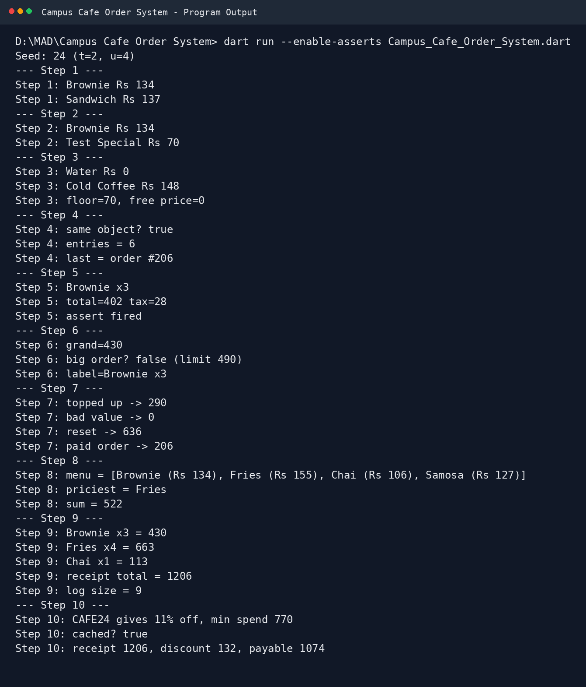

# Campus Cafe Order System

A beginner-friendly **Dart** implementation for **CS442 – Mobile Application Development, Lab 3**.

This project demonstrates classes, constructors, named constructors, factory constructors, initializer lists, assertions, getters, setters, collections, receipt generation, and discount coupons.

## Project Information

| Item | Details |
|---|---|
| Course | CS442 – Mobile Application Development |
| Lab | Lab 3 – Campus Cafe Order System |
| Language | Dart |
| Student Roll No. | `04072312024` |
| Seed | `24` |
| Tens digit (`t`) | `2` |
| Units digit (`u`) | `4` |
| Main File | `Campus_Cafe_Order_System.dart` |

## Project Structure

```text
Campus Cafe Order System/
├── Campus_Cafe_Order_System.dart
├── program_output.png
└── README.md
```

## Features Covered

1. **Classes and Objects** – `Dish`
2. **Constructors and `this.` shorthand** – `MenuItem`
3. **Named Constructors** – `free()` and `fromString()`
4. **Factory Constructor** – shared `OrderLog`
5. **Initializer Lists and Assertions** – `OrderLine`
6. **Getters** – `grand`, `isBigOrder`, and `label`
7. **Setters** – validated `StudentCard.balance`
8. **Collections and `toString()`** – menu building, `reduce()`, and `fold()`
9. **Receipt Building** – `buildReceipt()`
10. **Discount Coupons** – cached `Coupon` objects and discount calculation

## Seeded Values

The program uses the last two digits of the roll number:

```text
Roll No: 04072312024
Seed: 24
t = 2
u = 4
```

The resulting settings are:

```text
Price floor: 70
Tax: 7%
Big order limit: 490
Balance cap: 640
Coupon: 11%
```

## How to Run

Open a terminal inside the project folder:

```powershell
dart format .
dart analyze
dart run --enable-asserts Campus_Cafe_Order_System.dart
```

The `--enable-asserts` option is required for the assertion test in Step 5.

## Program Output

The output provided for this project is:

```text
Seed: 24 (t=2, u=4)
--- Step 1 ---
Step 1: Brownie Rs 134
Step 1: Sandwich Rs 137
--- Step 2 ---
Step 2: Brownie Rs 134
Step 2: Test Special Rs 70
--- Step 3 ---
Step 3: Water Rs 0
Step 3: Cold Coffee Rs 148
Step 3: floor=70, free price=0
--- Step 4 ---
Step 4: same object? true
Step 4: entries = 6
Step 4: last = order #206
--- Step 5 ---
Step 5: Brownie x3
Step 5: total=402 tax=28
Step 5: assert fired
--- Step 6 ---
Step 6: grand=430
Step 6: big order? false (limit 490)
Step 6: label=Brownie x3
--- Step 7 ---
Step 7: topped up -> 290
Step 7: bad value -> 0
Step 7: reset -> 636
Step 7: paid order -> 206
--- Step 8 ---
Step 8: menu = [Brownie (Rs 134), Fries (Rs 155), Chai (Rs 106), Samosa (Rs 127)]
Step 8: priciest = Fries
Step 8: sum = 522
--- Step 9 ---
Step 9: Brownie x3 = 430
Step 9: Fries x4 = 663
Step 9: Chai x1 = 113
Step 9: receipt total = 1206
Step 9: log size = 9
--- Step 10 ---
Step 10: CAFE24 gives 11% off, min spend 770
Step 10: cached? true
Step 10: receipt 1206, discount 132, payable 1074
```

### Output Screenshot



> **Note:** The image above is a clean terminal-style reconstruction of the output you provided, so it is suitable for documentation. It is not a screenshot captured directly from your computer.

## Reflection

### Q1. What does constructor shorthand save?

The `this.` shorthand saves us from writing separate assignments such as `this.name = name`. It makes the constructor shorter and easier to read.

### Q2. Named constructor vs factory constructor

A named constructor is useful when a class needs another clear way to create an object. A factory constructor is useful when the class needs control over which object is returned, such as returning a shared or cached object.

### Q3. Constructor body vs initializer list

An initializer list runs before the constructor body and is useful for initializing final fields. The constructor body runs after initialization and can perform additional logic.

### Q4. Why use getters and setters?

A getter is useful when a value is calculated from other data. A setter is useful when we need to validate or control a value before storing it.

## Verification

**Status: ✅ Output is correct**

The provided output is consistent with:

- Seed `24`
- `t = 2`
- `u = 4`
- Step 5 assertion firing with `--enable-asserts`
- Step 10 coupon cache returning the same instance
- All ten required steps printing successfully

## Notes

The assignment brief officially uses the filename `lab3.dart`, but this project is currently using the descriptive filename `Campus_Cafe_Order_System.dart`. For an LMS submission, use the filename required by your instructor if they specifically require `lab3.dart`.
